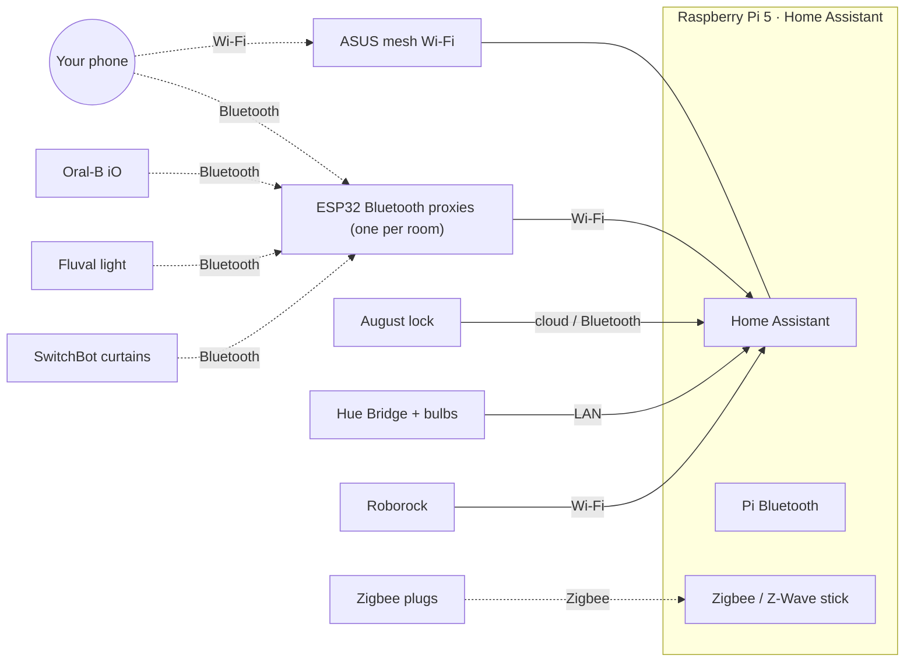

# HouseMaxer

**A smart apartment on a Raspberry Pi, with the code, the parts list, and how
we built it.**

The front door unlocks as you walk up to it and locks when you leave. Brushing
your teeth at night fades the lights and closes the curtains. The fish tank
light follows a sunrise and sunset you set from your phone. A robot vacuum and
a dot for *you* move across a live map of your home. It all runs on one
Raspberry Pi with [Home Assistant](https://www.home-assistant.io/), on your own
network, with no monthly fees.

This repo is everything you need to build the same thing in your own home:
step-by-step guides, the code we wrote, ready-to-use Home Assistant files, the
parts we bought (with links), and the AI prompts we used to build the parts we
couldn't buy. Our own floor plan, model and keys stay private; you bring your
own. The two dashboard cards (the live map and the 3D home) are the one thing
you build yourself: the guides and prompts walk you through it.

> **Affiliate links:** As an Amazon Associate HouseMaxer earns from qualifying
> purchases. The product links in this repo are affiliate links: buying through
> them costs you nothing extra and helps fund the project.

## What it does

| | Feature | Guide |
|---|---|---|
| 🧠 | Raspberry Pi 5 running Home Assistant, plus three ways to buy the hardware | [1](docs/01-raspberry-pi-and-home-assistant.md) |
| 📶 | Mesh Wi-Fi that tells Home Assistant who is home | [2](docs/02-network-asus-router.md) |
| 📡 | ESP32 boards, a few dollars each, that spread Bluetooth to every room | [3](docs/03-esp32-bluetooth-scanners.md) |
| 📍 | Room-level tracking from your phone's Bluetooth, calibrated, on a live map | [4](docs/04-room-tracking.md) |
| 🔐 | Front door unlocks as you walk up, locks when you leave | [5](docs/05-front-door-lock.md) |
| 💡 | Hue lights with a bedtime fade, and normal light again next morning | [6](docs/06-hue-lights.md) |
| 🪟 | Motorised curtains on the rod you already have | [7](docs/07-switchbot-curtains.md) |
| 🐠 | Fluval aquarium light in Home Assistant (our own integration) | [8](docs/08-fluval-aquarium.md) |
| 🤖 | Roborock on your floor plan, and a robot that calibrates your tracking | [9](docs/09-roborock-vacuum.md) |
| 🪥 | Bedtime starts when you brush your teeth | [10](docs/10-toothbrush-bedtime.md) |
| 🏠 | A live 2D map and a 3D model of your home on the dashboard | [11](docs/11-dashboards-and-3d.md) |

## How it fits together



## The main parts

The full list, with what each part is for, is in **[PARTS.md](PARTS.md)**.

| Part | Link |
|---|---|
| Raspberry Pi 5 (8 GB) | [Board](https://www.amazon.com/pi5_8gb/dp/B0CK2FCG1K?tag=maxestmax-20) · [Starter kit](https://www.amazon.com/pi5_kit/dp/B0CRSNCJ6Y?tag=maxestmax-20) · [Home Assistant Green instead](https://www.amazon.com/ha_green/dp/B0CXVKSG19?tag=maxestmax-20) |
| microSD card | [128 GB A2](https://www.amazon.com/microsd/dp/B09X7BK27V?tag=maxestmax-20) |
| ESP32 Bluetooth boards | [ESP32 multipack](https://www.amazon.com/esp32/dp/B0D8T53CQ5?tag=maxestmax-20) · [USB-C cables](https://www.amazon.com/usbc_cable/dp/B08LH5SX4V?tag=maxestmax-20) · [USB wall chargers](https://www.amazon.com/usb_wall/dp/B0GYMWK6K4?tag=maxestmax-20) |
| Zigbee stick | [SONOFF ZBDongle-E](https://www.amazon.com/zigbee_alt/dp/B0B6P22YJC?tag=maxestmax-20) (ours is a HUSBZB-1, no longer sold) |
| Wi-Fi | [ASUS ZenWiFi mesh](https://www.amazon.com/s?k=ASUS+ZenWiFi+mesh+WiFi+system&tag=maxestmax-20) (ours is the XT8, now sold used) |
| Smart lock | [August Wi-Fi Smart Lock](https://www.amazon.com/august_lock/dp/B082VXK9CK?tag=maxestmax-20) (we bought ours used on eBay) |
| Lights | [Hue Bridge](https://www.amazon.com/hue_bridge/dp/B016H0QZ7I?tag=maxestmax-20) · [Hue color A19](https://www.amazon.com/hue_a19_color/dp/B0FNX74DZK?tag=maxestmax-20) |
| Curtains | [SwitchBot Curtain](https://www.amazon.com/switchbot_curtain/dp/B0F8BR5Q66?tag=maxestmax-20) · [SwitchBot Hub 2](https://www.amazon.com/switchbot_hub2/dp/B0BM8VS13P?tag=maxestmax-20) |
| Aquarium | [Fluval Flex 32.5 gal](https://www.amazon.com/fluval_flex/dp/B07JDTXTGR?tag=maxestmax-20) · [Zigbee plug](https://www.amazon.com/zigbee_plug/dp/B09LV53X62?tag=maxestmax-20) for the UV filter |
| Robot vacuum | [Roborock Qrevo Plus, Renewed](https://www.amazon.com/roborock_qrevo_plus_renewed/dp/B0FMKBBFLR?tag=maxestmax-20) · [main listing](https://www.amazon.com/roborock_qrevo_plus/dp/B0D2Y8MY5T?tag=maxestmax-20) |
| Toothbrush | [Oral-B iO Series 9](https://www.amazon.com/oralb_io/dp/B0B5HSNPNH?tag=maxestmax-20) |

**Buy the expensive things used.** Our lock came from eBay and our robot
vacuum was refurbished. Smart locks, robot vacuums, mesh routers and Hue
bridges sell used for far less and work the same. Reset them to factory
settings before you set them up.

## What's in this repo

```
docs/                       step-by-step guides (start with 01)
homeassistant/packages/     Home Assistant YAML you can drop into /config/packages/
  presence_lock.yaml          walk-up unlock, lock on leave, away latch, lock self-heal
  bedtime.yaml                toothbrush → bedtime fade, curtains, default-scene restore
  aquarium.yaml               Fluval sunrise/sunset schedule run by Home Assistant
  roborock_live_position.yaml robot position in floor-plan feet
custom_components/
  fluval_ble/                 Home Assistant integration for Fluval Bluetooth lights
  roborock_pose/              Roborock heading + robot-carried calibration recorder
esphome/                    one firmware for every ESP32 Bluetooth scanner
tracking/                   room tracker: floor plan → walls, calibration, fit, map engine
prompts/                    the AI prompts we used to build the custom parts
tools/                      helper scripts (parts links, aquarium dashboard)
PARTS.md                    the full parts list
```

## Before you start

- **Change entity IDs.** Every YAML file says at the top which entity IDs to
  replace with yours (Settings → Devices & services → Entities shows them).
  `presence_lock.yaml` needs `bedtime.yaml` too.
- **Never commit secrets or your layout.** Tokens, Wi-Fi passwords, your
  phone's IRK, your floor plan, calibration files and 3D scans belong in files
  that `.gitignore` already skips (`secrets.yaml`, `floorplan*.json`,
  `calib*.json`, `samples*.jsonl`, `*.usdz`, `*.glb`...). Run `git status`
  before every commit and read the list.
- **Locks are serious.** Read the safety notes in
  [guide 5](docs/05-front-door-lock.md) before you turn on walk-up unlock.

## Credits

- Home Assistant users worked out the Fluval light protocol, mainly mrzottel
  with an ESPHome `fluval_ble_led` component, in the
  [Fluval Aquasky BLE thread](https://community.home-assistant.io/t/fluval-aquasky-ble-rgb-light/259598).
- Room distances come from [Bermuda](https://github.com/agittins/bermuda) by
  agittins.
- Built with [Home Assistant](https://www.home-assistant.io/),
  [ESPHome](https://esphome.io/) and [three.js](https://threejs.org/), and
  with a lot of help from Claude.

Product names and trademarks belong to their owners. HouseMaxer is not tied to
or backed by any of the brands named here.

## License

[MIT](LICENSE). Use it, change it, share it.
